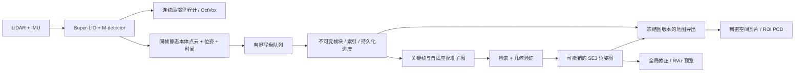

# 大场景长距离建图修改计划

设计日期：2026-10-20；实施记录更新：2026-10-21。状态：流式存储与导出已实现；
回环后端已实现并通过功能测试，真实质量准入与几十公里验收仍未完成。
目标环境：本仓库、Ubuntu 22.04、ROS 2 Humble、`vslam` Docker；不增加 ROS 1 支持。
本文件是总实施计划，[回环技术细节](loop_closure_plan.md)作为配套说明，以本文件的实施顺序、
存储接口和质量验收为准。

目标是持续构建几十公里地图，同时保持当前有效静态点云的覆盖、密度和局部精度，
通过经验证的回环提高全局一致性。把“不降低质量”设为功能启用和发布的验收门槛，
而非对未测试场景作无条件精度承诺。只有通过真实连续长距离数据验证，才能宣称对应里程支持。

## 实施状态（2026-10-21）

以下正文保留设计约束，不能把全部设计项视作已交付。可执行命令与证据见
[README](../README.md#大场景流式建图)及[验证记录](streaming_validation.md)。

| 阶段 | 当前状态 |
|---|---|
| S0 | NCLT / Retail 完整回放已完成；NCLT 同构建新旧模式 10,200 帧轨迹完全一致；尚缺人工标注负样本集与独立 GT |
| S1–S3 | 本体静态帧/实际参考时间、无损写盘、索引/校验/恢复、外排序加权体素导出已实现；两数据集旧滤波等价检查通过 |
| S4 | 路径/计时统计/输入和写盘队列已限额；全量回放与队列/部分写入故障测试通过；长时/整容器并发预算仍待验证 |
| S5 | 按需读云、稀疏关键帧图、无回环原位姿保持已实现并通过测试 |
| S6 | 检索、粗细配准、退化/邻帧/未来帧门槛、鲁棒核、撤销已实现；真实 NCLT 独立几何检查未全面改善，默认关闭回环 |
| S7 | 同版本全帧位姿、异步保存、原始/优化瓦片、ROI、限量浏览已实现；优化图局部质量全面验收未通过 |
| S8 | 未通过；目前约 1.1 km NCLT 数据不能代表 30–50 km。前端 float 未改为移动原点，大坐标、慢盘/断电恢复与持续长时预算仍需专项验证 |
| S9 | 未实施，保留可选 |

当前无自动丢帧或降密度策略。写入超过容量时明确停止并标记 incomplete。
存储格式首版为不压缩 XYZI；单独保存扫描起止与实际去畸变参考时刻，未添加全部 ESKF
质量诊断字段。冷点云按需读入后释放，没有固定常驻 256 MiB 历史云缓存。
后端配准目前使用有界帧上下文和点数上限，没有实现信息自适应节点增密或 LiDAR BA。
`parameters.yaml`/`provenance.json` 由新统一 launch 记录；直接启动裸节点不会自动记录所有参数。

实现目录为 `map/store/{frames,index.txt,manifest.json}`、`graph/`、`maps/{raw,optimized}/`；
第 5.3 节的目录树为设计示意，以 README 当前输出结构为准。
依赖已锁定并在 Humble 构建验证，参见 `third_party/backend/versions.json`。

## 1. 质量基线与必须遵守的约束

| 项目 | 修改约束 |
|---|---|
| 前端估计 | 首轮保留 ESKF、去畸变、OctVox 插入与淘汰语义；时间修复或数值精度调整单独提交、回归 |
| 前端参数 | 保留两数据集现有外参、IMU 噪声、采样率、在线体素及匹配参数；不自动减小体素容量 |
| 动态过滤 | 保留当前 M-detector 参数和调用顺序；后端使用筛选后的静态云 |
| 建图输入 | 保留当前全部有效静态处理帧，不因关键帧距离或 RViz 节流漏存中间帧 |
| 原始帧存储 | 点坐标与属性无损保存；不预先做第二次不可逆的点云降采样 |
| 最终地图 | NCLT 继续使用 0.10 m，Retail_Street 继续使用 0.05 m；地图采样独立于预览和配准 |
| 优化策略 | 六自由度；拒绝优先；有异常检查、版本记录和错误边撤销；无合格回环时保持原始里程计 |
| 资源不足 | 先暂停预览、限制后台并发或减慢离线回放；不自动丢建图帧、调粗最终体素或改变动态筛选 |
| 运行产物 | 地图、轨迹、状态在 `outputs/<run>/`，日志统一放在 `log/` |

“全部有效静态处理帧”指现有前端完成过滤后用于建图的数据，不等于保留所有传感器原始点。
每份结果保存输入标识、Git 版本、参数、传感器参考坐标与地图体素，便于公平比较。
优化失败或质量检查不通过时，保留原始轨迹/地图作为可用结果，不覆盖基线。

## 2. 当前需要改造的代码

| 位置 | 当前问题 | 修改方向 |
|---|---|---|
| `super_lio/src/lio/super_lio.cpp::caceData()` | 同步写 PCD，提前合并世界坐标点，丢失帧归属 | 改为不可变帧记录入队，后台写盘 |
| `ProcessCaceMap()` / `saveMap()` | 退出时把所有分片加载入内存再合并 | 改为刷新存储并提交索引，地图导出由独立工具完成 |
| `super_lio/include/common/map_voxel_filter.h` | 稀疏键避免范围溢出，但哈希仍随整图点数增长 | 提取可分块合并的统计量，按瓦片外存归并 |
| `super_lio/src/ros/ROSWrapper.cpp::pub_odom()` | 每移动约 0.1 m 追加并重发完整路径 | 在线限长/低频/抽样，完整轨迹单独保存 |
| `ROSWrapper` 输入缓冲 | DDS 和应用层缓冲需要统一计量与过载处理 | 检查帧号、时间、队列字节数和等待时长 |
| `super_lio/include/common/timer.h` | 保存每次调用的耗时向量，随运行时间增长 | 在线统计量＋固定窗口/直方图 |
| `basic/include/basic/alias.h` 等 | 当前计算基础类型为 float，长距离需核查数值误差 | 全局锚点/位姿图 double，前端精度专项验证 |
| 验证脚本 | 主要检查运行、点数和单进程 RSS | 增加几何质量、帧完整性、多进程/容器资源和分块结果检查 |

OctVox 已有容量淘汰；不将拦截淘汰体素作为主存储接口。它的代表点最多融合 20 个合格点，
并非全部历史观测，也不能代替当前密度的静态帧。NCLT 当前在线体素 0.5 m 的子体素约 0.25 m，
不能只导出代表点后声称仍保留了 0.10 m 地图细节。

## 3. 架构与包划分



| 拟新增包 | 职责 | 依赖边界 |
|---|---|---|
| `super_lio_mapping` | C++ 帧格式、写盘、索引、读缓存、体素统计、瓦片导出 | 主要依赖 Eigen/PCL，不依赖图优化器和后端节点 |
| `super_lio_interfaces` | `FrameCommitted`、`MappingStatus` 消息，保存/导出服务 | 公共 ROS 2 接口，避免前后端依赖循环 |
| `super_lio_backend` | 关键帧、配准子图、回环、位姿图、质量报告及导出节点/工具 | 依赖公共包和已锁定的几何/优化库 |

前端只负责估计和把帧交给写盘线程；高开销后端在独立进程运行。
以本地帧存储为完整数据来源，ROS 通知仅用于唤醒后端，通知丢失可通过索引补读。
不依靠两个高带宽点云/里程计话题的近似同步维持地图完整性。
首版前端不接收 PGO 状态反馈，TF 使用 `map -> world -> body`，前端连续坐标保持独立。

## 4. 四种粒度分别管理

| 对象 | 选择依据 | 保存的信息 |
|---|---|---|
| 优化关键帧 | 运动、可观测性、约束需求 | 原始/优化位姿、关联帧、质量与噪声 |
| 配准子图 | 重叠、视场、局部误差和计算上限 | 可按需重建的局部配准云和描述子 |
| 磁盘存储块 | 字节数、最长提交时间、可恢复性 | 多帧无损记录及块内偏移索引 |
| 导出空间瓦片 | 全局体素键、查询范围、导出版本 | 指定分辨率下的稠密静态点云 |

不把“20 个关键帧”同时当成以上四种对象。磁盘分块不决定优化自由度，稀疏关键帧不决定
地图输入密度。配准云允许降采样；用于最终重建的帧云保持不变。

## 5. 帧记录、异步写盘与恢复

### 5.1 不可变帧记录

每个处理帧生成一个内部 C++ `FrameRecord`，至少包含：

- run/session/frame ID，扫描起止时间、点云去畸变参考时刻、配套位姿时刻。
- 本体/IMU 坐标的静态点云，原始位姿、外参版本及参考坐标定义。
- 前端输入/保留/动态点数、匹配有效点数、退化标志等质量字段。
- 点格式、数值类型、点数、字节长度及校验值；可选原始 ESKF 协方差只作诊断。

在动态筛选与位姿估计完成后取同一个状态快照，排在可视化节流之前。
必须核实真实点云参考时刻与位姿是否一致；不能只改消息时间戳。若发现需要传播/插值，
将其作为独立修复，先通过局部结构、轨迹和去畸变回归，再进入新存储流程。
不可在后端重复给已是世界坐标的 `/lio/cloud_world` 乘位姿。

### 5.2 写盘与完整性

- 前端向按字节限制的队列提交不可变点云所有权，禁止传出稍后会被修改的共享缓存。
- 帧块采用显式版本化二进制格式，支持按帧定位；压缩仅采用无损方式，如可选 LZ4。
  不直接序列化带内存填充的 C++ 结构体，不丢失已有静态点属性。
- 用“最大块字节数或最长提交时间，先到者触发”关闭帧块。写临时文件，校验并按持久化
  策略同步后提交索引；只有完整提交的记录才能发布 `FrameCommitted`。
- 明确区分 processed、queued、written、durable 四个帧号进度，后端从 durable 进度补读。
  日志显示积压字节、最老帧等待时间、写盘速度和最后持久化帧。
- 首版不以无锁队列为前提；先采用边界清晰、可测试的队列，只有实测锁竞争才替换。
- 写盘持续不足时，离线验证协调器暂停/减慢播放；实时输入优先保留原始录包以供重建。
  在实际输入超过可持续存储能力时停止并标记 incomplete，不用无限内存或静默丢帧维持运行。

完整性按前端实际接受的可建图帧核对；初始化帧、末尾缺 IMU 帧等单独列明原因，不冒充存储丢失。
现有 NCLT 基线为 10,200 个输出位姿，不能机械要求等于包内 10,212 个扫描。

### 5.3 目录和恢复

```text
outputs/<run>/
├── manifest.json              # 版本、配置、坐标、提交进度和完整性状态
├── frames/                    # 不可变的局部静态帧块
├── index/                     # 帧偏移、关键帧归属与空间索引
├── graph/                     # 因子账本、原始/可信优化快照
├── trajectory/                # raw / optimized 轨迹
├── maps/<graph_version>/
│   ├── raw/tiles/             # 按原始轨迹生成的地图瓦片
│   ├── optimized/tiles/       # 按可信优化轨迹生成的地图瓦片
│   └── manifest.json          # 体素、瓦片边界、点数、输入帧上限、图版本
├── exports/                   # 用户请求的 ROI / 整图 PCD
└── reports/                   # 质量和资源验证结果
log/<相关运行日志>/
```

崩溃后扫描块尾及索引，隔离未完整提交的数据，恢复已持久化帧并支持重新导出、重新优化。
不覆写上次 run，不使用 `/tmp` 作为唯一地图存储。
恢复已有地图不等于精确恢复实时 ESKF/M-detector 状态。实时重启先开新 session，必须经
验证的重定位/跨 session 回环才能连接旧图；禁止直接按单位变换拼接，禁止自动跨 session 里程计边。

## 6. 稠密地图的外存导出

1. 固定输入帧上限 N 和可信图版本 V，保存一致的位姿快照；导出期间新输入/优化使用新版本。
2. 顺序读取帧块，在限定工作区内把局部静态点变换到版本 V 的全局坐标，不缓存整条轨迹点云。
3. 按统一全局体素键分配空间瓦片；瓦片写入临时分桶文件，受限缓存满时落盘。
4. 每次处理一块瓦片；瓦片仍过大时继续分桶/外排序归并，不能退回无限增长的全图哈希。
5. 生成目标密度点云、校验和和索引，整个版本完成后再发布地图清单。

全局体素键统一使用 `floor((point - grid_origin) / leaf)` 和有符号 64 位索引，
瓦片归属从体素整数键计算。叶尺寸、网格原点、负坐标与边界规则全部版本化。
这防止各瓦片独立设原点造成接缝、重复和边界缺点。

体素累计保存 `sum_x, sum_y, sum_z, sum_intensity, count` 等统计量；分批合并必须按 count
加权，不能直接平均两个质心。不可变局部帧仍作为未来优化的来源；临时世界坐标分桶结果
只属于当前导出版本，不能跨图版本重复使用。

NCLT 最终 leaf 固定 0.10 m，Retail_Street 固定 0.05 m。在线预览使用单独分辨率和点数上限。
同分辨率下，回环减少重复体素可能降低点数，质量检查应比较覆盖和结构，而非只比较总点数。

大图默认交付完整瓦片及 manifest，按 ROI 按需生成单个 PCD；小图可以保留 `map/map.pcd`
兼容输出。不得把低密度预览保存为同名文件，冒充原来的稠密地图。
单文件导出需要预先统计点数或正确回填头部，不能串接多个完整 PCD 或独立压缩块。
格式约束见 [PCL PCD 说明](https://pointclouds.org/documentation/tutorials/pcd_file_format.html)。

## 7. 回环后端与局部精度

### 7.1 首版选型

采用原生 Humble 轻量后端：Scan Context 基线检索＋KISS-Matcher 困难初值粗配准＋
small_gicp 多尺度精配准＋GTSAM iSAM2。几何库只负责配准，帧存储和缓存由本仓库控制。
[KISS-Matcher ROS 2 示例](https://github.com/MIT-SPARK/KISS-Matcher/blob/main/ros/README.md)
作为接入参考，不直接沿用其全量关键帧/地图缓存。

GTSAM 4.3.0 是独立后端的候选固定版本，需先与几何依赖在当前容器通过构建和数值验证；
riSAM 放入后续对照，不作为首版必须条件。[官方发布说明](https://github.com/borglab/gtsam/releases/tag/4.3.0)
所选源码全部锁定提交，避免构建时拉浮动 master；构建工具若需 CMake >= 3.24，使用隔离前缀。
不得为了接入示例直接替换现有 ROS 环境或加载其他工程的安装目录。

GLIM 用于地图质量和资源对照，若持续几何优化明确改善子图内部误差，再单独评估引入。
它当前的[全局模块](https://github.com/koide3/glim/blob/master/src/glim/mapping/global_mapping.cpp)
仍持有几何数据，不能仅在存盘后清空点云；若选用，按 GLIM/gtsam_points 兼容组合重新锁定依赖。
SC-PGO 原 ROS 1 实现只作逻辑参考，不引入 ROS 1 或 ROS bridge。

### 7.2 图和配准子图

- 建立 SE(3) 关键帧图，首帧先验＋相邻里程计边；无回环阶段应复现原始轨迹。
- 关键帧从约 2 m、10°、运动中最长约 2 s 开始调试。只影响图密度，不影响静态帧保存。
- 保留所有帧到关键帧的相对位姿。配准子图由邻近帧按需构建，不永久把几十米所有点
  烘焙成一个不可细化的刚体。重访、转弯或局部质量下降时允许增加图节点。
- 不直接把 ESKF 后验协方差当成相对位姿边噪声；不把未经标定的 GICP Hessian 当精确置信度。
  首版使用经独立片段标定的保守噪声，明确旋转/平移、单位和扰动约定。
- 不将已用于前端的 IMU 作为独立测量简单重复加权；联合惯性平滑留到独立方案。

普通非关键帧可由锚点关键帧 k 修正：

```text
T_map_Bj = T_map_Bk_opt * inverse(T_world_Bk_raw) * T_world_Bj_raw
```

该方式保留短区间局部运动。相邻锚点修正不连续时，评估 SE(3) 平滑插值或增密图节点，
在固定结构 ROI 上检查接缝。若仍有子图内部畸变，进入局部多帧优化/离线 LiDAR BA 对照，
不能仅靠整体移动子图宣称精度提升。

### 7.3 回环正确性与回退

- 描述子全局检索与里程计空间检索并行；全局入口不能因里程计漂移超出半径而失效。
- 历史云按需加载，配准结束释放临时引用；线程数、候选数、历史缓存字节数有明确上限。
- 检查双向重叠、内点空间分布、残差、退化、重力合理性和邻帧一致性；单一 fitness 或
  粗配准内点数不能证明回环正确。重复走廊、反向重访、动态残留必须纳入负/正样本。
- 回环先进入候选图，检查几何与优化残差再发布可信版本；保存边来源、因子 ID、噪声和拒绝原因。
- 使用鲁棒核并具备因子撤销/按账本重建。相关邻帧约束不能无限重复计数，无回环时不强制闭合。
- 自动检查只能拒绝明显异常；最终发布前仍需独立 ROI/真值验收，不能把参与配准的同一批点
  的残差下降当作唯一精度证据。原始地图和最近可信版本始终可恢复。

## 8. 内存、时间和可视化

需要控制的是以下工作集，而不仅是点云容器：

```text
总资源 = 前端活跃地图与动态历史 + 输入队列 + 写盘队列 + 解压/读取缓存
       + 配准临时数据 + 优化器/描述子/索引 + 导出工作区 + 发布缓存
```

点云工作集按字节设上限；描述子、元数据和因子图允许随节点缓慢增长，但需测量与容量规划。
50 km / 25 m 已约 2,000 个子图，关键帧图可能更多，不能预设只有几百个节点或固定毫秒耗时。
若增长超出资源预算，再引入经质量对照验证的图稀疏化/层级图，不直接丢约束或固定滑窗删旧图。

- 冻结 OctVox 当前容量与分辨率作为第一轮基线；容量下降必须独立验证，不作为默认节省手段。
- 对 DDS 和应用队列共同计量，不使用无限 keep-all；离线控制播放与实时输入分别制定策略。
  IMU 不能按普通可视化消息处理，过载时禁止随意抽样。
- 后端先限制到 1–2 个配准任务并发，导出只运行一个大工作任务；具体线程数在容器实测确定，
  避免 TBB、OpenMP 和后端同时抢占全部核。
- `/lio/path` 改为有限长度预览，完整轨迹持续保存；全局路径仅发布简化线段。
- 全局点云预览低频、限点数，仅显示附近或当前视区所需瓦片；精细数据按 ROI 加载。
  预览降采样与磁盘地图密度分离，RViz 使用 AxisColor、Move Camera，避免累计旧图版本。
- Timer 改为在线计数/均值/方差和有界分位数统计；日志轮转，结果索引分批落盘。
- 前端总耗时必须包含快照、入队、发布和轨迹处理，并另报输入排队/端到端延迟；不能只计
  ESKF 等算法函数的耗时，掩盖保存或发布阻塞。
- 同时监测所有节点 RSS、Docker cgroup memory.current/limit、页缓存、磁盘与队列峰值，
  不以单进程 RSS 稳定作为完整内存验证。导出阶段同样纳入峰值。

## 9. 长距离坐标数值精度

位姿图、全局锚点、导出坐标计算使用 double；点云以局部 float 坐标存储，不提前写成很大的
全局 float 点。仅将已有 float 位姿转成 double 不会恢复已经损失的精度。

专项测试把同一段局部几何放在不同平移偏置（0、1、10、50 km，以及目标地理坐标）下，
比较最近邻、平面残差、匹配位姿和导出体素的变化。前端当前 float 的误差若不能满足质量门槛，
必须完成下述改造后才能宣称长距离通过，不能只因最终 leaf 为厘米级就忽略它。

优先验证完整的局部原点平移方案：内部坐标保持在邻近范围，以 double 保存连续全局原点。
平移时必须同步处理 ESKF 位置、OctVox 点/键与 LRU 顺序、动态过滤世界坐标历史、缓存状态和
输出坐标；推导协方差和残差约定，禁止只给 `p` 减常量。已有落盘帧和外部连续 `world` 不跳变。
方案必须经过往返等价、跨原点回环、动态历史和实时性测试；若代价过高，再对关键计算路径
比较 double 实现。此项单独提交，不与最初存储迁移混在一起修改。

## 10. 实施阶段与停止条件

每阶段独立提交和保存验证报告。依赖阶段未通过，后续功能只能作为实验开关，不能进入默认配置。

| 阶段 | 具体修改 | 通过条件 |
|---|---|---|
| S0 基线冻结 | 两数据集完整回放，配置/版本/ROI/资源记录；标注回环正负样本 | 可复现，测得浮点/并行重复运行波动，建立质量门槛 |
| S1 帧接口 | 内部 FrameRecord、同帧时间语义、静态本体云导出 | 帧身份/参考时刻正确，序列与前端处理帧一致；独立时间修复通过回归 |
| S2 流式存储 | 有界写盘、版本化块、索引、通知、错误处理和尾部恢复 | 无静默缺帧、点云无损往返；慢盘/失败可检测；不再同步写大 PCD |
| S3 等价导出 | 原始位姿外存分桶、加权体素归并、ROI/瓦片导出；替换全量合并 | 与原保存流程同密度/同覆盖，质心差仅在预定浮点容差内；峰值受限 |
| S4 持续运行 | 路径限长、统计限长、缓冲和并发预算、RViz 分离 | 稳态无点云/路径线性增长，队列不持续积压，输入完整性和前端精度不退化 |
| S5 后端骨架 | 按需读云、关键帧图、噪声约定、仅里程计优化 | 无回环时轨迹一致；不减少保存帧；关键变换和恢复测试通过 |
| S6 可信回环 | 检索、粗细配准、退化与邻帧验证、鲁棒核、图快照和撤销 | 标注集无已知错误接受，报告样本量/召回；错误边注入后可恢复 |
| S7 一致地图 | 非关键帧修正、全图版本、局部重建、保存服务、质量比较 | 轨迹/PCD/瓦片同版本；重访处改善且固定局部 ROI 不退化 |
| S8 长距离准入 | 坐标专项、恢复与故障测试、逐级真实连续长数据 | 在声明里程和容器预算内通过精度/资源验收；缺真实数据则明确尚未通过 |
| S9 可选增强 | riSAM、信息加权、漏回环补检、BTC/SOLiD、GLIM/离线 BA、GNSS | 各项独立 A/B，只启用实测有益且不破坏前端基线的改进 |

三个交付节点：S0–S4 为等价质量的流式建图；S5–S7 为可信回环和全局重建；
S8 通过后才是对应里程的大场景版本。S9 不作为首版必须依赖。

## 11. 拟修改文件与新增模块

| 文件/目录 | 计划改动 |
|---|---|
| `super_lio/src/lio/super_lio.cpp`、对应头文件 | 快照导出、异步存储入口、退出刷新，移除新模式的全量合并 |
| `super_lio/src/ros/ROSWrapper.cpp`、对应头文件 | 原始完整轨迹保存、限长在线路径、队列监控、提交通知 |
| `super_lio/include/common/timer.h` | 有界耗时统计 |
| `super_lio/include/common/map_voxel_filter.h` | 可合并体素统计与外存导出复用，保留已有小图行为 |
| `super_lio/src/lio/params.cpp`、对应头文件 | 参数校验、legacy/streamed 模式，资源与导出策略 |
| `super_lio_mapping/` | FrameRecord、ChunkWriter、FrameReader、IndexStore、CloudCache、TileExporter |
| `super_lio_interfaces/` | 提交通知、状态、保存/导出服务，包含 run/session/图版本 |
| `super_lio_backend/` | KeyframeManager、SubmapBuilder、CandidateSearch、LoopVerifier、PoseGraph、QualityReporter |
| 两数据集 YAML 与 launch | 独立的大场景开关、持久存储路径、配准和导出配置；现有质量参数保留 |
| `super_lio/rviz/` | 局部/全局视图、低频预览、回环标记、ROI 显示 |
| `scripts/build_humble.sh`、各 CMake/package.xml | 新包构建、固定依赖与日志目录，前端不依赖 GTSAM |
| `scripts/validate_retail_street.py`、NCLT 入口及新增验证脚本 | 分块地图、帧完整性、几何质量、容器资源与长时验证 |
| `tests/` | 存储恢复、边界体素、变换/图因子、错误回环、坐标原点专项测试 |
| 中英文 README、验证文档 | 新模式命令、产物、适用边界和实测结果；未实现命令不标为可用 |

建议新增 `validate_streaming.py`、`compare_map_quality.py`、`validate_long_run.py`；
验证脚本同时检查原始/优化结果，不能因为没有单个 map.pcd 就误判地图缺失。

## 12. 参数草案

以下保留设计时的参数意图；已实现的准确参数名和默认值以 README 与源码为准；
不把这些值解释为某种硬件已能达到的性能保证。

| 参数意图 | 起始选择 |
|---|---|
| 保存模式 | `legacy` 保留对照，`streamed` 为新实现；验收后再切换默认 |
| 写盘队列字节上限 | 128 MiB，单帧超过边界时明确处理；不允许无界溢出 |
| 帧块最大尺寸/提交间隔 | 32 MiB 或约 1 s；先到者触发，并记录真正 durable 延迟 |
| 历史点云缓存 | 256 MiB，含解压数据；配准工作区另计 |
| 导出工作区 | 256 MiB，过大瓦片二次分桶；并行工作数计入总预算 |
| 配准并发 | 1 个任务起步，明确限制几何库内部线程 |
| 优化关键帧 | 约 2 m / 10° / 运动中约 2 s，独立于地图保存 |
| 配准子图 | 从约 20 m 几何上下文起测，同时限制点数/内存，有限视场单独调试 |
| 瓦片边长 | 100 m 起测，必须对应整数个最终体素；拥挤块继续细分 |
| 最终体素 | NCLT 0.10 m，Retail_Street 0.05 m，沿用基线 |
| 在线显示 | 最近约 5,000 个路径点、约 1 Hz 路径；全局点云约 0.2 Hz 且有点数上限 |

这些缓存之和不是总内存预算。ESKF/OctVox、M-detector、DDS、图和第三方工作区均需实测计入，
再根据 vslam 的 cgroup 限额决定是否有足够余量；不通过自动牺牲精度适配不足的资源。

## 13. 质量与规模验收

先在 S0 选定固定的墙面、建筑角点、路沿、树干/杆体和重访区域，保存 ROI 定义，
区分调参片段与最终验收片段。距离误差尽量在未参与配准的保留帧或独立参考上测量，
避免同一批点既产生约束又证明自身精度。
原始/优化地图使用统一坐标基准和相同 ROI 规则，不能逐区域重新配准后掩盖全局漂移。

| 维度 | 硬性检查 |
|---|---|
| 存储等价性 | 同一帧输入点数/属性和校验一致；无帧漏存；负坐标、边界和重复访问归并正确 |
| 导出等价性 | 原始位姿、相同体素/原点和输入时，覆盖与体素统计一致；浮点容差在修改前确定 |
| 地图密度 | 固定 ROI 的占据体素覆盖、孔洞比例和邻域点距不下降；不以减少重复点误判稀疏 |
| 局部精度 | 墙厚、点到平面残差 P50/P95、直线/角点及接缝不劣于基线，超出重复运行波动即阻止默认启用 |
| 全局一致性 | 已确认重访的重影和双向残差改善，未重访 ROI 不退化；不以视觉闭合或回环条数代替精度 |
| 轨迹 | 有可靠独立 GT 时比较 ATE/RPE；统一时间/参考点，仅 SE(3) 对齐，不用尺度拟合掩盖误差 |
| 回环错误 | 相似不同地点、反向视角、低重叠、退化几何、动态残留、重复约束均有测试及逐边记录 |
| 持续运行 | 稳态队列不积压；点云缓存受限；元数据/图增长可解释；前端/后端/导出峰值均纳入容器预算 |
| 实时性 | 约 10 Hz 输入下前端目标 P95 < 100 ms，P99/排队时延单列，写盘/配准不造成新的数据丢失 |
| 故障恢复 | 慢盘、满盘、部分写入、进程终止、重复通知、回放时钟重置、导出期间优化均可检测并恢复一致版本 |

不预先允许“降低 5% 精度换取内存”；质量门槛按基线重复运行误差范围确定并冻结。
地图质量检查未通过的实验版本不替换默认输出，保留可信地图及失败原因。

验证分层：

1. 现有 NCLT 与 Retail_Street 全量回放，验证质量和兼容性；参考现有验证文档。
2. 长时间压力回放/合成大坐标测试，验证队列、索引、内存、恢复；重复 bag 不证明真实长距离精度。
3. 真实连续轨迹逐级验证约 5、10、30–50 km，包含有/无回环、反向重访、弱几何场景。
4. 每一级记录有效路程、时长、帧数、所有参数、硬件/容器限额、磁盘、质量和资源统计。

当前 NCLT 已有轨迹路程约 1.1 km，不能作为几十公里已经通过的证据。真正长距离准入需要
对应数据；缺少时完成前两层并明确第三层尚未验证。无重访且缺少外部约束的长路线，
不能仅凭 PGO 消除累计漂移；GNSS 需独立核对时间、天线外参和质量后再接入。

## 14. 完成定义

在声明里程和资源环境下：持续接收与存储完整静态处理帧；前端及导出内存可控；
地图密度/局部结构通过基线回归；真实回环提高全局一致性；错误约束能拒绝或撤销；
优化轨迹与最终瓦片同版本；异常后已持久化数据可恢复；本仓库 Humble 环境独立构建，
中英文使用文档与实测报告齐全。未满足的里程或精度项保留为未验证，不以程序未崩溃代替通过。
