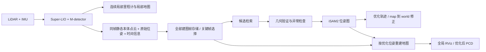

# ROS 2 Humble 回环检测与图优化实施计划

制定日期：2026-10-19。状态：方案设计，尚未实现后端或安装新增依赖。
适用环境：Ubuntu 22.04、ROS 2 Humble、`vslam` Docker、本仓库独立构建环境。

建议保留 Super-LIO＋M-detector 前端，增加独立进程运行的异步 SE(3) 位姿图后端。
先完成 NCLT 上可验证的回环、鲁棒优化和全量静态地图重建，再处理 Retail_Street 的
有限视场和更困难的重访。回环改善全局一致性；时间同步、外参、去畸变和局部匹配误差
仍需单独控制，错误回环可能使地图质量下降。

## 1. 技术选择与近期进展

| 环节 | 首版选择 | 后续增强与依据 |
|---|---|---|
| 前端 | 保留当前 Super-LIO、IMU 去畸变、M-detector 静态点筛选 | 后端不阻塞前端，不直接修改 ESKF 状态 |
| 候选检索 | NCLT 使用几何高度描述的 Scan Context 基线，叠加空间近邻候选 | Retail_Street 用累积子地图，比较 BTC / SOLiD；不依赖 NCLT 缺失的强度或 RGB |
| 回环验证 | KISS-Matcher 提供困难初值下的粗配准，small_gicp 多尺度 GICP 精配准 | 几何重叠、退化检查、邻帧一致性共同决定是否入图 |
| 图优化 | 固定 GTSAM 4.3.0，iSAM2，6 自由度位姿、里程计边、鲁棒回环边 | 基线稳定后比较 riSAM；错误边始终保留撤销和重建机制 |
| 地图 | 保存所有处理帧的静态点云及其局部坐标归属；用优化位姿重建 | 图节点稀疏化与地图点云密度分开配置 |
| 质量提升 | 同时评估轨迹误差和重访处几何一致性 | 加入几何信息加权、优化后的漏回环补检，必要时研究离线 LiDAR BA |

上述组合是针对本仓库的工程选择，不是各模块在所有数据上的性能排名。

- [Scan Context / Scan Context++](https://github.com/gisbi-kim/scancontext_tro)
  适合作为轻量几何检索基线，不属于最新方法。NCLT 的 360° 扫描适合先建立基准；
  有限视场 Livox 的效果需要单独验证。
- [KISS-Matcher](https://github.com/MIT-SPARK/KISS-Matcher)
  及其 [ROS 2 KISS-Matcher-SAM 示例](https://github.com/MIT-SPARK/KISS-Matcher/blob/main/ros/README.md)
  提供外部里程计接入与几何回环参考。计划复用配准核心及实现经验，自行适配当前帧接口。
  [small_gicp](https://github.com/koide3/small_gicp) 提供 CPU 并行 GICP 配准。
- [GTSAM 4.3.0 官方发布说明](https://github.com/borglab/gtsam/releases/tag/4.3.0)
  包含 iSAM2 改进与 riSAM 鲁棒增量优化。新后端优先锁定此版本；不把“采用新版”当作
  当前 Humble 环境已经兼容的证明，需要先完成构建及数值验证。
- [2026 年 7 月的地图一致性研究预印本](https://arxiv.org/abs/2607.13516)
  提出几何相关信息矩阵、检索与配准分离、优化后补检漏回环，并评估重访处地图一致性。
  本计划借鉴这些思路，不声称直接复现论文，也不将其 ICP 信息公式直接套到 ESKF。
- [BTC](https://github.com/hku-mars/btc_descriptor)
  和 [SOLiD](https://github.com/sparolab/SOLiD) 是后续几何检索候选。
  BTC 原工程包含 ROS 1/catkin 依赖，若采用，只提取几何核心并编写 Humble 封装。
- [HOTFLoc++（RA-L 2026）](https://github.com/csiro-robotics/HOTFLoc)
  可作为学习型检索、重排序和位姿估计的对照。其依赖和训练域需要单独验证，放在可选
  推理进程中；首版不要求 GPU，也不改变 Humble 的系统 Python 环境。

## 2. 当前代码必须先解决的问题

审查入口：`super_lio/src/lio/super_lio.cpp` 中的 `DynamicFilter()`、`Output()`、
`UpdateMap()`、`caceData()`，以及 `basic` 中的 ESKF 状态接口。

1. **配对的本体点云与位姿尚未作为独立接口输出。** `ds_undistort_` 经动态过滤后是
   本体/IMU 坐标静态点云；`/lio/cloud_world` 已被变换到 `world`，不能再当作本体点云
   乘一次位姿。可视化的 dense 模式还可能含动态点，后端不能直接复用它作为静态地图输入。
2. **现有话题时间语义不完全相同。** 动态过滤结果使用扫描结束时间，里程计使用滤波状态
   时间。新增接口必须明确点云的去畸变参考时刻与配套位姿时刻，必要时传播/插值到同一
   时刻；仅修改消息时间戳不能消除实际时间差，也不能依赖近似同步来猜测帧配对。
3. **当前保存逻辑提前合并世界坐标点。** `caceData()` 变换并拼接点云，最终 PCD 不再
   保留点与帧的对应关系。回环后只修改轨迹或给整张地图乘一个刚体变换，无法修复历史漂移。
4. **优化结果不能直接写回 ESKF。** 位姿突变会使 `ivox_` 局部地图、动态过滤历史、速度、
   重力、协方差等不一致。首版只提供独立全局修正，前端仍在连续的 `world` 坐标中工作。
5. **ESKF 协方差不能直接当图边噪声。** 当前是 18 维状态后验协方差；两个时刻状态存在
   相关性，其前 6×6 子块不是相邻关键帧的相对位姿协方差。GICP Hessian 也不是无需
   标定即可使用的精确信息矩阵。

## 3. 目标数据流与坐标约定



新增 `super_lio_interfaces` 消息包与 `super_lio_backend` C++ ament 包。
前端仅依赖公共消息接口，后端不侵入 ESKF；关闭后端时保持现有建图流程。
高开销检索、配准、优化、地图重建分别排队处理，并记录队列长度和耗时。

TF 采用 `map -> world -> body`：`world` 沿用当前前端局部坐标，承担通常的 odom 角色；
后端仅发布 `map -> world`。局部话题保持 `world`，优化后的地图和路径使用 `map`，
避免同一 TF 子坐标系出现两个发布父节点。

统一记 `T_A_B` 为从 B 到 A 的变换。相邻关键帧里程计边为：

```text
Z_ij = inverse(T_world_Bi_raw) * T_world_Bj_raw
```

配准时以当前帧 j 为 source、历史帧 i 为 target，得到的 `T_Bi_Bj` 与该边方向一致。
首节点先验取首帧原始位姿，保持前端的重力朝向和坐标基准。
初版只有位姿先验、里程计边和已验证回环边，不把同一份 IMU 再作为独立测量重复计入。

## 4. 分阶段实施与交付

按下面六个阶段逐项验收。阶段 1–5 构成可运行的首版，阶段 6 是质量增强。

| 阶段 | 修改范围 | 交付与通过条件 |
|---|---|---|
| 1：冻结基线和依赖 | 两数据集复现、回环样本标注、依赖锁定 | 保存配置/版本/原始轨迹/地图/耗时；新增依赖在 vslam 内构建通过 |
| 2：建立帧接口与存储 | 前端输出、公共消息、后端帧存储 | 点云/位姿严格同帧同参考时刻；全部静态建图帧可重放，地图密度不因关键帧选择而减少 |
| 3：构建无回环位姿图 | 关键帧、先验、里程计边、iSAM2 | 无回环时优化结果与原始里程计在数值容差内一致；变换和噪声约定测试通过 |
| 4：加入回环检测与验证 | 候选检索、配准、过滤、边审计 | 已标注真回环通过，负样本被拒绝；每条边可解释、可撤销，不强制产生回环 |
| 5：全局输出与地图重建 | TF、全局地图、RViz、保存服务、验证脚本 | 轨迹和 PCD 使用同一优化版本；确认实际结构改善，前端实时性和全部帧保存通过 |
| 6：近期方法增强 | 信息加权、漏回环补检、riSAM、有限视场检索 | 逐项 A/B 评估，只有测得收益的功能才进入默认配置 |

### 阶段 1：基线和依赖

- 在同一份输入、外参、动态过滤设置及导出体素下保存前后对照，固定 bag 回放速度、线程数
  和配置。建立真回环、相似但不同地点、无重访三类样本，不仅依赖里程计距离标注。
- 当前容器 CMake 为 3.22.1，未检测到已安装的 GTSAM 开发包。
  [KISS-Matcher ROS 2 示例 CMake](https://github.com/MIT-SPARK/KISS-Matcher/blob/main/ros/CMakeLists.txt)
  要求至少 3.24，并从浮动 `master` 获取 small_gicp。实施时固定源码提交和依赖清单，
  使用隔离的构建工具前缀满足要求；不要仅降低最低版本声明。
- GTSAM 4.3.0 与所选 KISS-Matcher 核心先做兼容性构建。如果必须使用较旧依赖，明确记录
  版本退回原因，并重新验证接口；不混用两个 GTSAM ABI。第三方源码和原许可证在本仓库
  `third_party/` 管理，不加载 FAST-LIVO2 或 Lightning 的安装环境。
- 依赖构建记录与所有运行日志写入 `log/`，结果写入 `outputs/<run>/`。

### 阶段 2：帧接口、时间与密度

- 新建 `MappingFrame.msg`，每个已处理建图帧包含单调 `session_id/frame_id`、扫描起止时间、
  点云参考时刻、配套原始位姿、静态本体点云、前端质量字段。后端据此选择关键帧。
  跨 bag 重放、时间重置必须开启新 session，禁止跨 session 连边。
- 接口放在动态筛选和位姿估计完成后，从同一个状态快照生成，不受 `output.dense`、
  RViz 发布节流或 `g_pub_step` 影响。先核实去畸变到扫描结束时的状态一致性。
- 点云保存分两路：配准/描述子使用稀疏云；建图存储保留当前密度的全部静态处理帧。
  首版导出继续采用 NCLT 0.10 m、Retail_Street 0.05 m 的最终体素，不把图节点间距
  当成点云采样间距。不混入未经过动态过滤的 dense 可视化云来增加点数。
- 每个非关键帧记录其关键帧锚点和原始相对位姿；缓存采用磁盘分块加内存 LRU。
  配准队列允许丢弃过期检索任务，建图帧存储必须检查连续性；写盘来不及时显式报告
  缺帧或背压，不能悄悄丢帧后宣称完整地图。

### 阶段 3：仅里程计图

- 初始关键帧条件：平移约 2 m、旋转约 10°，或运动中距上次关键帧超过 2 s。
  参数只是调试起点，静止状态不持续新增节点。
- 使用 SE(3) 节点和相对里程计 Between 因子。首版从独立数据标定保守的平移/旋转噪声，
  随关键帧跨度调整，并给退化帧降低权重；保留协方差升级接口。
- 测试源/目标方向、雷达到 IMU 外参、左右扰动、旋转/平移排列、弧度/米单位，以及
  一段已知 6 自由度轨迹。禁止把轨迹约束简化成只优化平面 x/y/yaw。
- 保存因子来源、噪声模型与优化快照，为错误回环撤销、重建和离线复现提供依据。

### 阶段 4：检索、配准与错误回环控制

- NCLT 首先使用 Scan Context；建立“全局描述子检索”和“里程计空间近邻”两个候选入口。
  空间入口可从半径 20 m、时间间隔 60 s、Top-K=5 起调；全局入口不能受此半径硬限制，
  否则大漂移时真正的回环永远不会进入验证。
- 将邻近历史静态帧聚合成目标子地图；有限视场输入再增加当前侧的局部累积。
  检索可使用较大上下文，配准使用更小、内部漂移可控的子地图。
- 初值可信时先做多尺度 GICP；初值不可信或反向重访时，使用 KISS-Matcher 粗配准，
  再 GICP 精配准。局部优化收敛不等于地点正确。
- 验证同时检查双向重叠、内点比例、残差分布、内点空间覆盖、几何退化、重力方向合理性，
  以及邻近帧得到的相对变换一致性。阈值从标注样本确定，不能只靠一个 fitness 分数。
- 初版使用 Huber 等鲁棒核，并保留入图前后残差检查与撤销能力。重复的同一回环不重复
  加边；相邻多个高度相关配准结果不能被当成完全独立证据反复提高置信度。
- 回环记录包括候选来源、配准变换、质量指标、接受/拒绝原因、因子 ID 和图版本。
  遇到疑似错误约束时隔离该边，按因子账本重建最近可信图。

### 阶段 5：修正地图、保存和 RViz

- 后端基于最新优化关键帧计算 `T_map_world = T_map_Bk_opt * inverse(T_world_Bk_raw)`，
  发布全局修正。历史轨迹逐帧重算，不能全部套用“当前时刻”的单一修正矩阵。
- 对锚定到关键帧 k 的建图帧 j，首版使用：

  ```text
  T_map_Bj = T_map_Bk_opt * inverse(T_world_Bk_raw) * T_world_Bj_raw
  ```

  这保留关键帧之间的局部运动。通过短锚定区间和重访结构检查评估残余接缝；需要时再加入
  相邻关键帧修正的 SE(3) 插值或更细图节点，避免长期大子地图整体刚性移动的局限。
- 用全部静态帧重建全局地图，分块读取和体素合并；不一次将所有原始点及多份地图留在内存。
  在线可低频发布降采样全局预览，保存时才生成目标密度的完整 PCD。
- 新增 `/slam/path_optimized`、`/slam/map_optimized`、回环边 Marker 与配准调试显示。
  后端 RViz 使用 `map` 固定坐标和 Move Camera；全图消息表示最新地图快照，避免将回环
  前后的扫描在 RViz 中持续累计。不能只修正 TF、继续堆积旧点云后声称全图已优化。
- 保存服务等待输入帧、优化任务与最终地图快照完成，统一图版本，再原子写入结果目录。
  Ctrl-C 尽量完成相同收尾流程；异常退出保留已落盘帧和因子账本供恢复。
- 输出 `map_raw.pcd`、`map_optimized.pcd`、原始/优化 TUM 轨迹、图与边记录及验证报告。
  两张地图使用相同静态帧和最终体素。优化后重叠体素合并，点数可能减少，不能据此判定变稀疏。

### 阶段 6：质量增强

1. 信息加权：从几何可观测性、残差及关键帧跨度估计经过标定的边权重，限制过强置信度。
   对 GICP 与 ESKF 分别推导和验证，不能将 ICP 论文的信息公式直接复制过来。
2. 漏回环补检：一次可信优化后，在修正后的轨迹附近重新检索旧帧，仍经完整几何验证；
   设置冷却时间、候选上限和重复边去重，避免自我强化的错误回环循环。
3. 抗异常优化：在相同候选和标注上比较 iSAM2＋鲁棒核与 riSAM；包含注入错误边的测试，
   达到精度和耗时门槛后再决定默认策略。
4. 有限视场：对 Retail_Street 比较 Scan Context 子地图、BTC、SOLiD；选取实测效果和
   运行成本适合的一项，不将三套描述子全部作为默认依赖。
5. 局部精修：若全局闭合后仍有明显墙厚/子地图内部畸变，再研究离线 LiDAR BA。
   [HBA](https://github.com/hku-mars/HBA) 可作参考，其原工程有 ROS 1 和旧版依赖，
   需要提取核心并适配，不能直接加入当前 Humble 构建。

GNSS 融合作为独立扩展；只有检查时间、坐标、天线杆臂和质量标志后才讨论加入。
包内存在 GPS 话题并不意味着它可直接用作真值或可靠约束。

## 5. 验证数据与验收标准

NCLT 先作为首版验证集，Retail_Street 用于验证有限视场、动态场景和无回环退化行为。
不以“有一条回环边”作为完成条件。

现有 `outputs/nclt_20261019_145119_931142/trajectory/NCLT_20130110.txt` 的轨迹粗查：
以约 1 Hz 抽样，跨度约 1024 s、路程约 1132 m，首尾相距约 527 m。
相对序列起点约 429–534 s 与约 281–369 s 的片段存在空间接近候选，可优先人工核查。
这些数字来自当前里程计，只是候选线索，不是真值、不代表已经检测到回环，也不应强制首尾闭合。

| 检查项 | 验收方式 |
|---|---|
| 前端回归 | 关闭后端复现当前结果；开启后端不新增输入丢失，时间戳/session/帧号连续性可审计 |
| 无回环行为 | 仅里程计图与原轨迹一致；无合格回环时正常输出，不添加人为闭合 |
| 回环正确性 | 标注反向重访、局部重叠、相似走廊等正负样本；逐边核查并报告 precision/recall 和样本量 |
| 错误边恢复 | 注入假回环、重复边、退化平面、时间重置；错误约束被拒绝或可撤销恢复 |
| 轨迹精度 | 有独立 GT 时比较 ATE/RPE，校正时间和传感器参考坐标；只做 SE(3) 对齐，不以尺度拟合掩盖误差 |
| 地图结构 | 相同输入、静态过滤和最终体素下，对照重访区域的点到平面残差、墙厚和双向距离分布；保留截图与数值 |
| 地图完整性 | 非关键帧仍进入最终地图；点云片段无静默丢失，优化轨迹/PCD/图使用同一版本 |
| 性能 | 1× 回放统计前端/后端 P50/P95、内存、磁盘和队列；前端目标 P95 < 100 ms（约 10 Hz），作为待验证预算 |
| 保存一致性 | 正常退出、保存服务与异常恢复均可复现；保存结束前等待最终优化和重建，无根目录日志 |

NCLT 的独立真值从[数据集官方来源](https://robots.engin.umich.edu/nclt/)核对时间和坐标定义后使用。
若当前转换数据无法可靠对齐真值，则报告几何一致性和回环标签结果，不宣称绝对定位精度。
阈值调参和最终验收使用不同片段；Retail_Street 若没有经确认的重访，还需补充实际闭环序列，
该数据只能验证不开错误回环与运行性能。

## 6. 预计文件范围与完成边界

拟新增公共消息包、后端包、两数据集后端 YAML、后端 launch / RViz 配置与验证脚本；
拟修改前端帧导出、构建脚本的依赖选择、地图保存协调，以及中英文 README。
后端内部拆分 `FrameStore`、`KeyframeManager`、`CandidateSearch`、`LoopVerifier`、
`PoseGraph`、`MapBuilder`，检索和优化策略可替换，避免将所有逻辑塞进 `super_lio.cpp`。

首版完成边界是：Humble/vslam 可独立构建，NCLT 的真实回环经验证后改善重访结构，
Retail_Street 的有限视场/无回环行为有记录，优化轨迹和稠密静态 PCD 一致，日志集中管理。
GPU 学习模型、直接反馈修正 ESKF、联合 IMU 平滑、GNSS、离线 BA 均独立评估后再扩展。
